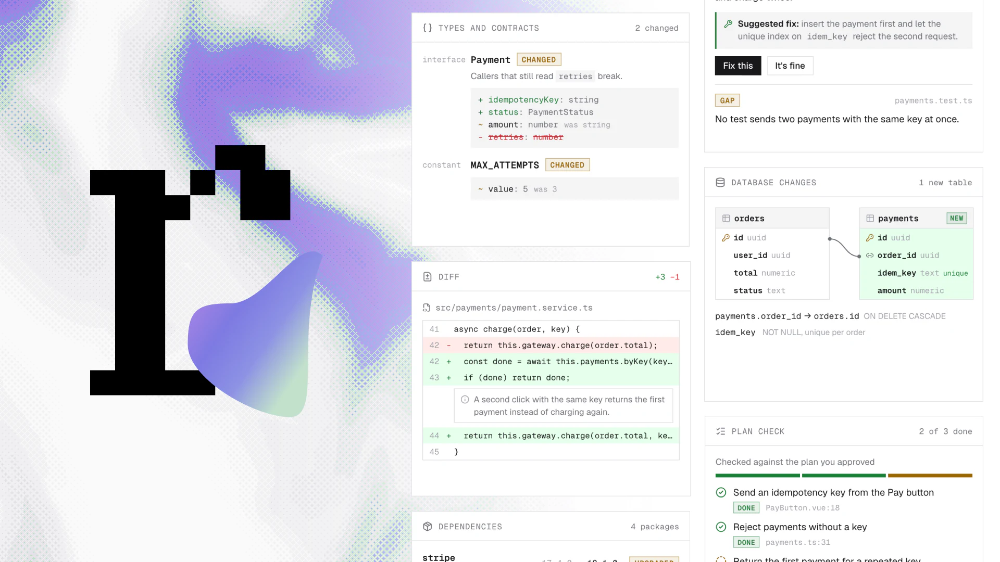

<p align="center">
  <picture>
    <source media="(prefers-color-scheme: dark)" srcset="docs/brand/reflektor-logo-dark.svg">
    
  </picture>
</p>

<p align="center">
    <a href="https://github.com/bashovski/reflektor/blob/main/LICENSE"></a>
   <a href='http://makeapullrequest.com'></a>
</p>

<p align="center">
  <a href="https://reflektor.dev">Platform</a> - <a href="https://reflektor.dev/docs">Documentation</a> - <a href="https://reflektor.dev/install">Install</a> - <a href="https://reflektor.dev/examples">Examples</a> - <a href="https://github.com/bashovski/reflektor/issues/new?assignees=&labels=bug&template=bug_report.yml">Report a Bug</a>
</p>

<picture>
  <source media="(prefers-color-scheme: dark)" srcset="docs/readme-hero-dark.webp">
  
</picture>

# Reflektor - code review on steroids

[Reflektor](https://reflektor.dev) is a skill and a powertool for coding agents that turns a branch into a review report in your browser.

## Features
Run on your own machine, or in the cloud. Do it solo, or collaborate with your team. 

- **Technology-agnostic**: Works with any language, framework, or database
- **Review Loops**: iterate on your branch, and generate a new report with each commit until perfection
- **Collaboration**: share a report with your team on [reflektor.dev](https://reflektor.dev), and get your changes reviewed
- **Automatic Project Checks**: your project's own tests, linter and type checker run in the background while the report is written, and their results show up in the report as they finish
- **E2E UI Testing with Screenshots**: Each part of the UI is tested with screenshots, and the results are included in the report
- **How it Works**: a visualization of the request flow from UI to database, including the types, interfaces, enums and constants it adds, changes or removes
- **Database Changes**: a visualization of the database changes, including migrations and schema changes
- **Test Coverage**: a summary of the tests, including metrics and suggestions
- **Hooks**: Add pre-action hooks to run pipelines and tasks for report generation
- **Daemon**: Reflektor runs as a small local daemon that keeps every review in one inbox, updates open reports live while your agent works, and hands your comments back to the agent

## Get Started

Needs Node.js 18 or later and git. Pick your agent, run its command, then start a new session in a repo on a branch with changes. Run the same command again to update. The full guide is at [reflektor.dev/install](https://reflektor.dev/install).

<details>
<summary><strong>Claude Code</strong></summary>

```bash
curl -fsSL https://reflektor.dev/install.sh | sh
```

On Windows, in PowerShell:

```powershell
irm https://reflektor.dev/install.ps1 | iex
```

Then run `/reflektor`.

</details>

<details>
<summary><strong>Codex</strong> (needs a sandbox profile)</summary>

```bash
curl -fsSL https://reflektor.dev/install.sh | sh -s -- --target agents
```

On Windows, in PowerShell:

```powershell
& ([scriptblock]::Create((irm https://reflektor.dev/install.ps1))) -Target agents
```

That copies reflektor to `~/.agents/skills/reflektor`, where Codex reads skills. Start a new Codex thread, then run `$reflektor`.

Codex's default sandbox blocks three things reflektor needs:

- writing to the repo's `.git` folder: `.git/reflektor`, `.git/objects` and `.git/refs/reflektor`
- writing to `~/.reflektor`
- running a local server on `127.0.0.1`, which serves the review pages

Either run reflektor with full access, or give Codex a permission profile that allows those. This one worked in our tests (Codex CLI 0.169). Put it in the repo's `.codex/config.toml` and trust the project in Codex first: Codex ignores the config of a project it doesn't trust.

```toml
default_permissions = "reflektor-local"

[features]
network_proxy = true

[permissions.reflektor-local]
extends = ":workspace"

[permissions.reflektor-local.filesystem]
"~/.reflektor" = "write"

[permissions.reflektor-local.filesystem.":workspace_roots"]
".git/reflektor" = "write"
".git/objects" = "write"
".git/refs/reflektor" = "write"

[permissions.reflektor-local.network]
enabled = true
allow_local_binding = true

[permissions.reflektor-local.network.domains]
"127.0.0.1" = "allow"
"localhost" = "allow"
```

While you review in the browser, Codex waits for you in its current turn. If that turn has ended, type `$reflektor resume` and Codex picks up your comments.

</details>

<details>
<summary><strong>Cursor, Gemini CLI, GitHub Copilot and other agents</strong></summary>

Install into the folder your agent reads skills from:

```bash
curl -fsSL https://reflektor.dev/install.sh | sh -s -- --target <your agent's skills folder>
```

If your agent reads `~/.agents/skills`, use `--target agents`. Then ask your agent for a review report.

</details>

## Docs

The full documentation is at [reflektor.dev/docs](https://reflektor.dev/docs):

- [Install](https://reflektor.dev/docs#install)
- [Your first report](https://reflektor.dev/docs#first-report)
- [Review rounds](https://reflektor.dev/docs#review-rounds)
- [reflektor flags](https://reflektor.dev/docs#cli-flags)
- [Publishing a report to your team](https://reflektor.dev/docs#publish-report)

## Examples
We've built a large library of examples for you to explore. You can find them in the [Examples](https://reflektor.dev/examples).

## Requirements
- Node.js 18 or higher

## Contributing
Whilst feedback and bug reports are more than welcome, I don't mind external help. Pick any open issues and communicate here on GitHub.

## License
Reflektor is licensed under the [MIT License](https://github.com/bashovski/reflektor/blob/main/LICENSE). You are free to use, modify, and distribute this software in accordance with the terms of the license.

## Author
Anur Basic - [anurbasic.com](https://anurbasic.com)